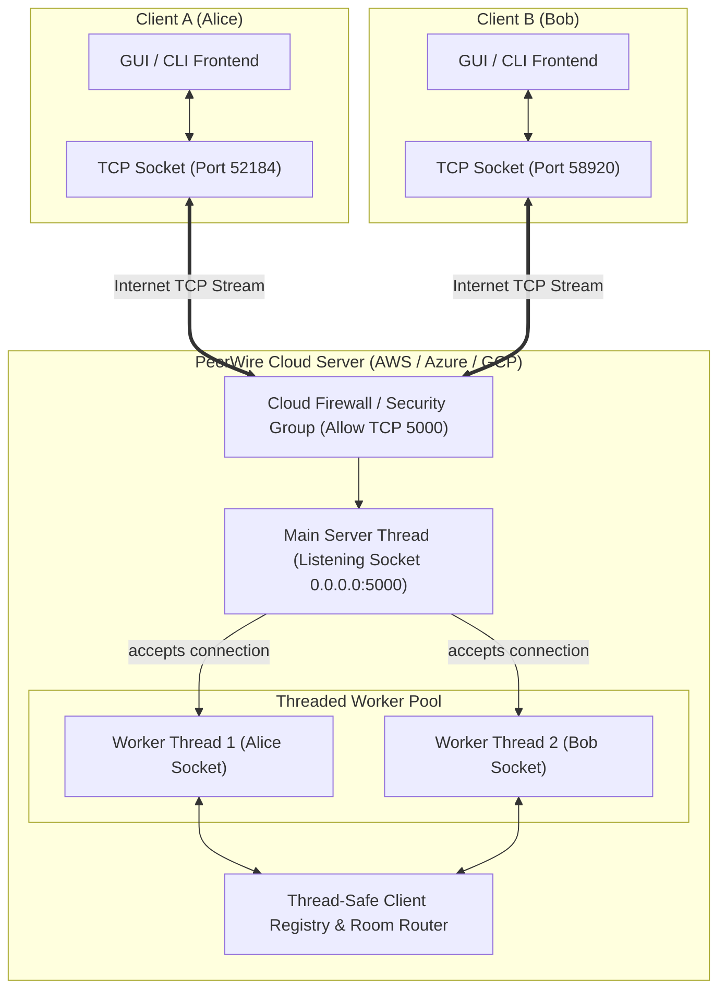
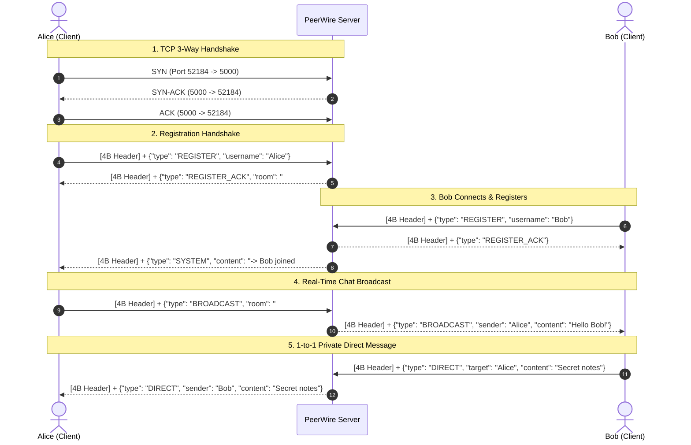

# PeerWire System & Network Architecture

This document describes the software architecture, transport-layer data flow, port mappings, and cloud deployment topology for the **PeerWire** chat platform.

---

## 1. High-Level System Architecture



---

## 2. Layer 4 Transport & Socket Demultiplexing

```
+-----------------------------------------------------------------------------------+
| OSI Model Layer        | Component in PeerWire                                    |
+------------------------+----------------------------------------------------------+
| Layer 7 (Application)  | PeerWire GUI (Tkinter) / CLI, JSON Command Framing       |
| Layer 4 (Transport)    | TCP Socket Stream (RFC 793), Port Multiplexing           |
| Layer 3 (Network)      | IP Addressing (IPv4 Unicast), Routing                    |
| Layer 2 (Data Link)    | Ethernet / Wi-Fi Frames                                   |
| Layer 1 (Physical)     | Electrical Signals / Fiber Optics                        |
+-----------------------------------------------------------------------------------+
```

### Connection State & Socket 5-Tuple:
Every connected client maintains a mathematically unique socket tuple at the operating system level:

$$\text{Session A} = \langle \text{TCP},\; \text{Client IP}: 52184,\; \text{Server IP}: 5000 \rangle$$
$$\text{Session B} = \langle \text{TCP},\; \text{Client IP}: 58920,\; \text{Server IP}: 5000 \rangle$$

---

## 3. Application-Layer Protocol Framing (TLV)

Because TCP is a continuous byte stream without packet boundaries, PeerWire uses **Length-Prefixed Framing**:

```
+-----------------------------+--------------------------------------------------+
| 4 Bytes (Network Byte Order)| Variable Length (N Bytes) UTF-8 Encoded JSON     |
+-----------------------------+--------------------------------------------------+
| struct.pack('>I', N)        | {"type": "BROADCAST", "content": "Hello!"}       |
+-----------------------------+--------------------------------------------------+
```

### Message Lifecycle Diagram:



---

## 4. Cloud Infrastructure Architecture (AWS / Azure / GCP)

```
                            [ Public Internet ]
                                     |
                                     v
                        [ Cloud Elastic Public IP ]
                                     |
                                     v
                       [ Cloud Virtual Firewall ]
                  (Inbound: Allow Port 22 SSH, Port 5000 TCP)
                                     |
                                     v
                  [ Virtual Private Cloud (VPC) / Subnet ]
                                     |
                                     v
                   [ Linux Cloud VM (Ubuntu 22.04 LTS) ]
                   +----------------------------------+
                   | systemd Daemon (peerwire.service)|
                   |      Python 3 Runtime            |
                   |      Listening on 0.0.0.0:5000   |
                   +----------------------------------+
```

### Cloud Security Group Specification:
* **Port 22 (TCP):** SSH Administrative Access (Restricted to developer IP).
* **Port 5000 (TCP):** PeerWire Custom TCP Socket Port (Open to `0.0.0.0/0` for public multi-user chat).
* **Outbound Rules:** All traffic allowed (`0.0.0.0/0`) for system updates.
