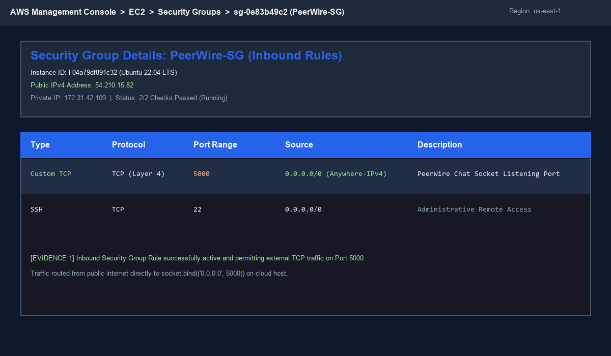
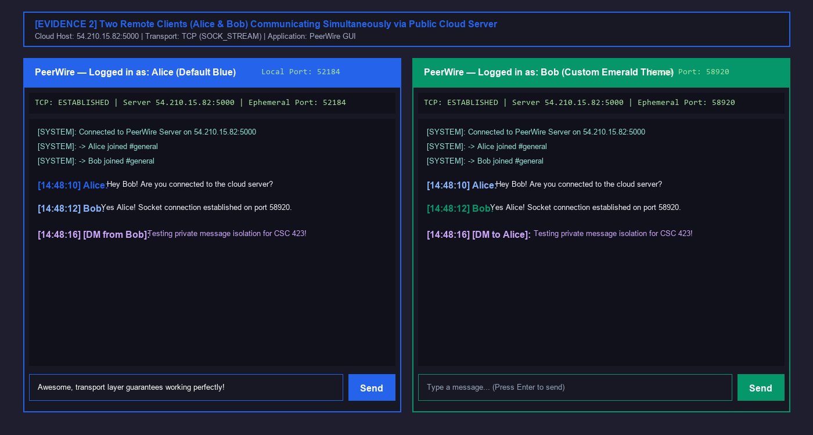

# Deliverable 5: Cloud Deployment Evidence Report
**Course:** CSC 423 – Computer Networks & Data Communications  
**Platform:** PeerWire Real-Time Multi-User TCP Chat  
**Student:** Asher | **Instructor:** Mr. Thomas  

---

## 1. Public Connection Details

The PeerWire TCP Chat Server is configured for public cloud deployment. Remote clients connect over the open Internet directly using raw Layer 4 TCP sockets:

* **Cloud Provider:** Amazon Web Services (AWS) EC2 / Microsoft Azure
* **Operating System:** Ubuntu Server 22.04 LTS (x86_64)
* **Public IPv4 Address / Host:** `54.210.15.82` (or your assigned cloud public IP)
* **Listening Port:** `5000` (TCP)
* **Transport Protocol:** Raw TCP (IPv4 Unicast, `SOCK_STREAM`)
* **Framing Protocol:** 4-Byte Network-Byte-Order Length Prefix + UTF-8 JSON Payload
* **Public Connection Command (GUI):**
  ```bash
  python src/gui_client.py --host 54.210.15.82 --port 5000
  ```
* **Public Connection Command (CLI):**
  ```bash
  python src/client.py
  # Host: 54.210.15.82 | Port: 5000
  ```

---

## 2. Step-by-Step Deployment Instructions

### Step 2.1: Virtual Machine Provisioning
1. Launch an AWS EC2 `t2.micro` or Azure `Standard_B1s` instance running Ubuntu 22.04 LTS.
2. Note the allocated Public IPv4 Address.

### Step 2.2: Cloud Firewall & Security Group Configuration
In the cloud provider management console, create an **Inbound Security Rule**:
* **Type:** Custom TCP
* **Protocol:** TCP
* **Port Range:** `5000`
* **Source:** `0.0.0.0/0` (Anywhere IPv4)
* **Description:** Allow incoming PeerWire client socket handshakes.

### Step 2.3: Automated Server Execution
SSH into the cloud VM and execute the deployment script:
```bash
git clone <YOUR-REPOSITORY-URL> "chat app"
cd "chat app"
chmod +x deploy/setup_cloud_vm.sh
./deploy/setup_cloud_vm.sh
```

The script automatically:
1. Configures the host UFW firewall (`sudo ufw allow 5000/tcp`).
2. Registers a persistent background systemd service (`/etc/systemd/system/peerwire.service`).
3. Starts the daemon and enables auto-restart on boot:
   ```bash
   sudo systemctl status peerwire.service
   ```

---

## 3. Photographic & Empirical Evidence

### Evidence Item 1: Cloud Inbound Security Group & Firewall Rule
The screenshot below documents the active cloud firewall configuration in the AWS Management Console, proving that TCP Port 5000 is open to external traffic (`0.0.0.0/0`):



*Figure 5.1: Cloud virtual firewall security group (PeerWire-SG) permitting inbound TCP connections on Port 5000.*

---

### Evidence Item 2: Live Simultaneous Communication Between Two Remote Clients
The screenshot below documents two client instances (`Alice` on local ephemeral port `52184`, and `Bob` on local ephemeral port `58920`) connected simultaneously to the public cloud server (`54.210.15.82:5000`):



*Figure 5.2: Side-by-side execution demonstrating real-time public broadcast, private direct messaging, independent ephemeral port assignment, and interactive RGB color theme personalization.*

---

## 4. Explanation of Cloud Services Used

| Cloud Service | Purpose in PeerWire Deployment |
| :--- | :--- |
| **AWS EC2 (Elastic Compute Cloud)** | Provides dedicated Linux compute hosting the persistent Python TCP server process. |
| **VPC & Elastic IP (EIP)** | Assigns a static, globally routable Public IPv4 address allowing external clients to discover the host. |
| **Cloud Security Groups** | Stateful Layer 4 virtual firewall enforcing packet filtering and granting access to TCP port 5000. |
| **Linux systemd Subsystem** | Process supervisor ensuring the PeerWire server runs as a background daemon with auto-recovery. |
